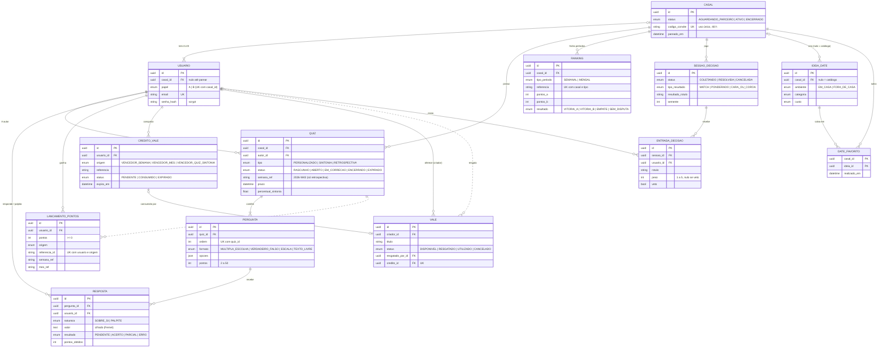
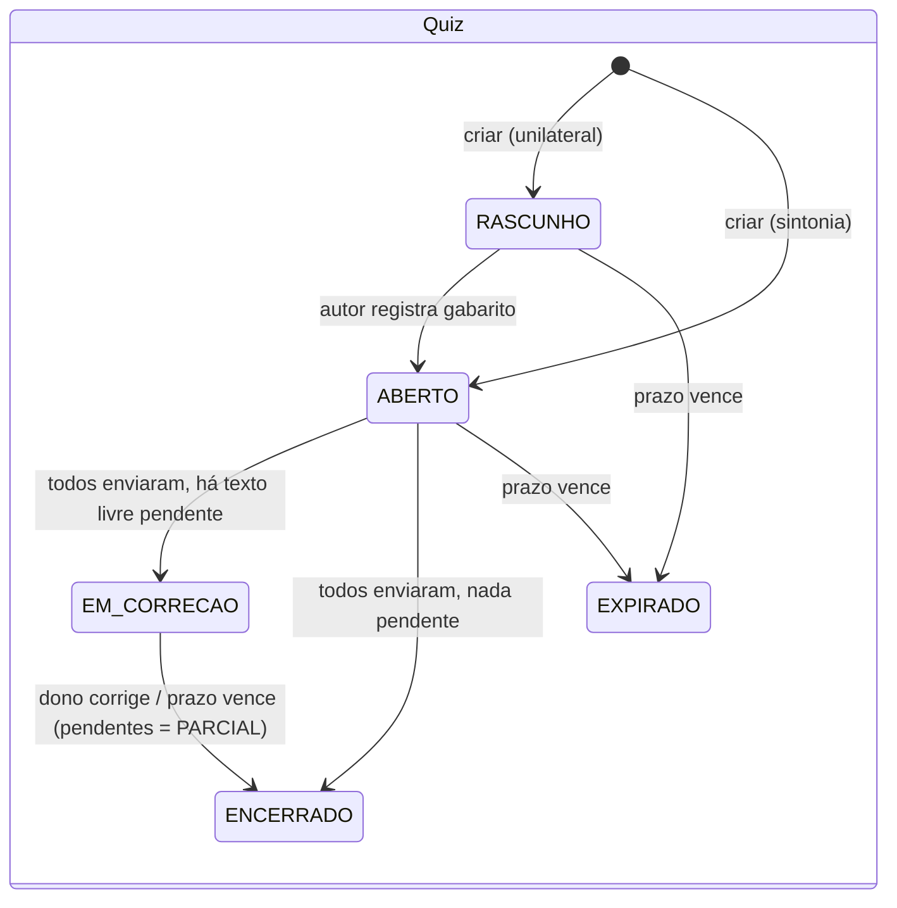
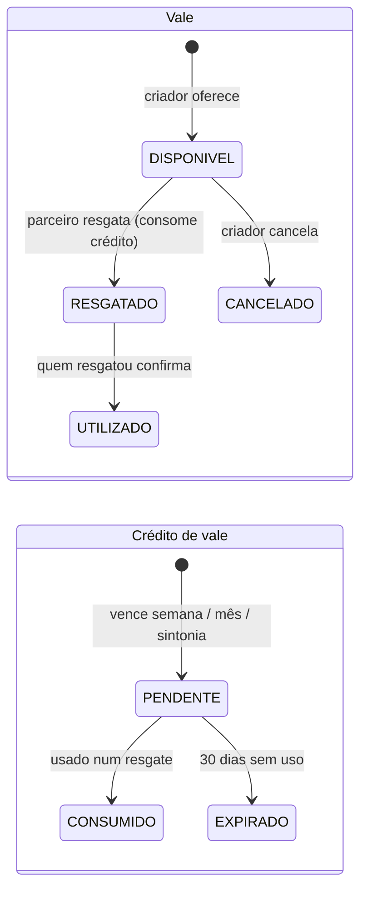
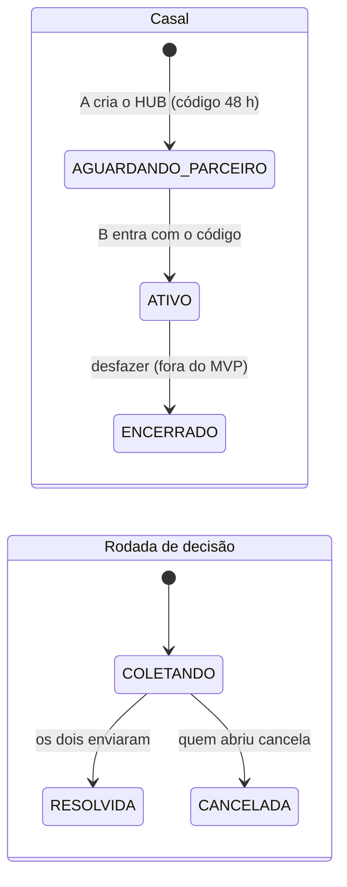

# Modelo de Domínio — CoupleHUB

> Implementação: `backend/app/models/*.py` (SQLAlchemy 2.0) · DDL equivalente: [`schema.sql`](schema.sql) · Diagrama renderizado: [`../img/modelo-er.svg`](../img/modelo-er.svg)

## 1. Visão geral

O **Casal** é a raiz de agregação: todo dado de interação pertence a exatamente um casal, e toda consulta da API é filtrada pelo `casal_id` do usuário autenticado (RB04). As oito entidades pedidas no enunciado estão presentes; cinco tabelas de apoio surgiram para que regras não triviais fiquem garantidas pelo próprio banco.

| Entidade pedida | Tabela | Observação |
| :--- | :--- | :--- |
| Casal | `casal` | Guarda status do pareamento e o código de convite de uso único. |
| Usuario | `usuario` | Papel `A`/`B` dentro do casal; UNIQUE (casal, papel) garante o 1:1. |
| Quiz | `quiz` | Unifica quiz personalizado, de sintonia **e retrospectiva semanal** (ADR-0003). |
| Pergunta | `pergunta` | Formato + pontos; opções em JSON só para múltipla escolha. |
| Resposta | `resposta` | `natureza` = `SOBRE_SI` (gabarito) ou `PALPITE`; valor **cifrado**. |
| Date | `ideia_date` | `casal_id` nulo = catálogo global; preenchido = ideia privada. |
| Vale | `vale` | Máquina de estados DISPONIVEL → RESGATADO → UTILIZADO (ou CANCELADO). |
| Ranking | `ranking` | Placar **fechado** de cada semana/mês (snapshot imutável). |

| Tabela de apoio | Por que existe |
| :--- | :--- |
| `lancamento_pontos` | Livro-razão só de inserção: fonte da verdade do placar; permite auditar "de onde veio cada ponto" e recalcular o ranking (ADR-0004). |
| `credito_vale` | Materializa "o vencedor ganha o direito de resgatar": sem ele não há como saber quantos resgates cada um ainda pode fazer. |
| `sessao_decisao` / `entrada_decisao` | Rodada do minigame com preferências e vetos secretos. |
| `date_favorito` | Associação N:N casal × ideia (favoritos e "já fizemos"). |

## 2. Diagrama entidade-relacionamento

## 3. Decisões de modelagem

1. **Retrospectiva é um Quiz.** "Como foi sua semana?" tem a mesma mecânica de um quiz unilateral (um conta, o outro adivinha). Reusar `quiz/pergunta/resposta` evita duplicar correção, pontuação e visibilidade. O que muda vive em colunas: `tipo = RETROSPECTIVA`, `semana_ref` obrigatória e índice único parcial `(autor_id, semana_ref) WHERE tipo = 'RETROSPECTIVA'` (uma por pessoa por semana). — ADR-0003
2. **Gabarito também é Resposta.** Em vez de uma coluna `gabarito` em `pergunta`, o gabarito é a resposta `SOBRE_SI` de quem é dono dele. Isso permite o modo SINTONIA (dois gabaritos na mesma pergunta) sem nenhuma tabela extra, e o mesmo `UNIQUE (pergunta, usuario, natureza)` impede envio duplicado.
3. **Ranking = livro-razão + snapshot.** Pontos nunca são editados, só lançados (`lancamento_pontos`, idempotente por `usuario + origem + referencia_id`). O placar aberto é um `SUM` ao vivo; ao fechar, grava-se uma linha imutável em `ranking`. Colunas `pontos_a`/`pontos_b` são aceitáveis porque o casal tem **exatamente** dois membros (invariante garantida por `uq_usuario_casal_papel`). — ADR-0004
4. **Semana pertence ao mês da sua quinta-feira** (regra ISO-8601). Cada semana cai em um único mês, então o total mensal é sempre a soma exata dos semanais.
5. **Crédito de vale é entidade, não contador.** Um contador `creditos` em `usuario` não diria de onde veio nem quando expira, e seria sujeito a corrida. Com a tabela, a emissão é idempotente (`uq_credito_origem`) e cada resgate aponta para o crédito que consumiu (`vale.credito_id UNIQUE`).
6. **Enums como VARCHAR + CHECK.** O SQLite não tem ENUM; o SQLAlchemy gera `CHECK (status IN (...))` automaticamente.
7. **UUID v4 em texto** como chave primária: não revela volume nem permite enumerar recursos de outros casais (RB04).
8. **Datas em UTC**, convertidas para `America/Sao_Paulo` só nas regras de calendário (`domain/periodos.py`).

## 4. Invariantes garantidas pelo banco

| Regra | Restrição |
| :--- | :--- |
| No máximo um Parceiro A e um B por casal | `uq_usuario_casal_papel` |
| Papel só existe com casal (e vice-versa) | `ck_usuario_papel_com_casal` |
| Só retrospectiva tem `semana_ref` | `ck_quiz_semana_so_retrospectiva` |
| Uma retrospectiva por pessoa por semana | `uq_retrospectiva_autor_semana` (índice parcial) |
| Um gabarito e um palpite por pessoa por pergunta | `uq_resposta_unica` |
| Gabarito não recebe nota | `ck_resposta_sobre_si_sem_nota` |
| Pontos não duplicam nem ficam negativos | `uq_lancamento_idempotente`, `ck_lancamento_pontos_positivos` |
| Um placar por casal × período | `uq_ranking_periodo` |
| Um crédito por usuário × origem × referência | `uq_credito_origem` |
| Crédito usado em um só vale | `vale.credito_id UNIQUE` |
| Ninguém resgata o próprio vale | `ck_vale_nao_proprio` |
| Status do vale coerente com o resgatador | `ck_vale_resgate_coerente` |
| Veto não tem peso; preferência tem peso 1–5 | `ck_entrada_peso` |

Todas foram exercitadas contra o `schema.sql` no SQLite (inserções válidas aceitas, inválidas barradas).

## 5. Máquinas de estado

